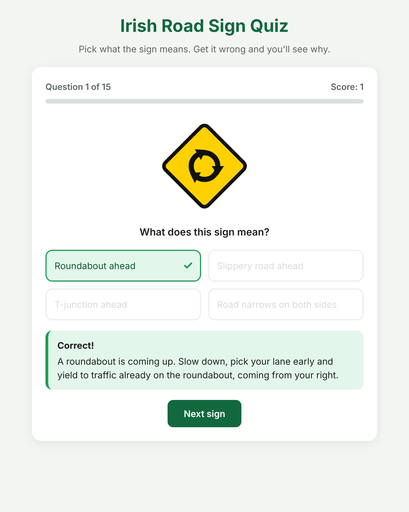
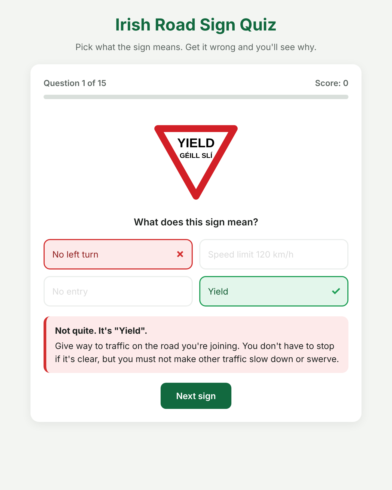
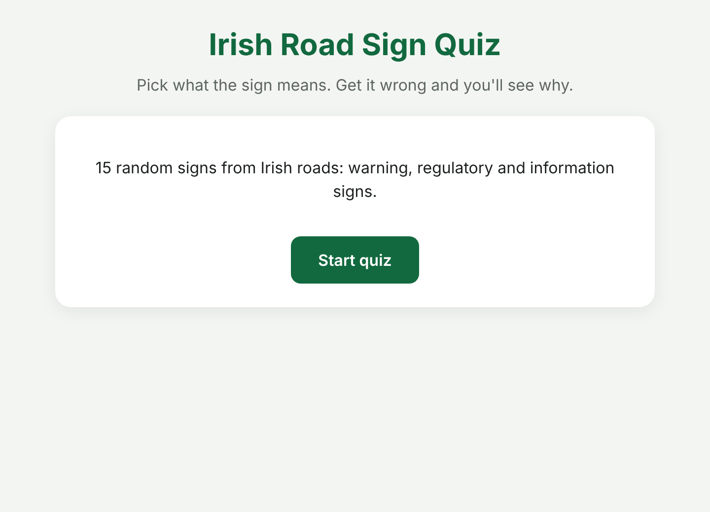
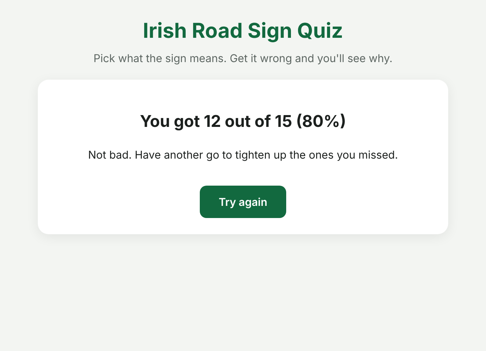
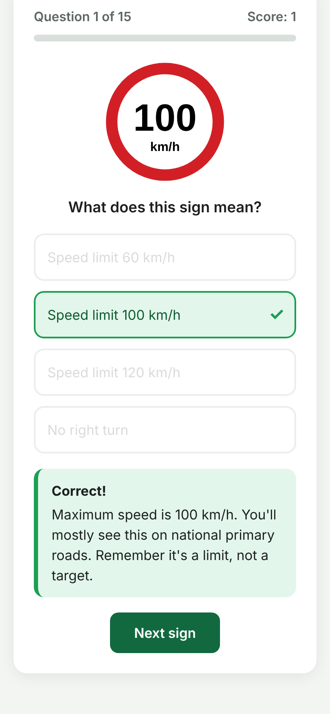

# 🚦 Irish Road Sign Quiz

A quiz for learning Irish road signs before your driver theory test. You get 15 random signs with 4 answers each, and every sign comes with an explanation of what it means.

**[Play the quiz →](https://c20744531.github.io/irish-road-sign-quiz/)**

## Screenshots

| Right answer | Wrong answer |
|---|---|
|  |  |

| Start | Results | Phone |
|---|---|---|
|  |  |  |

## How it works

- Each round picks 15 signs at random from 27
- Pick the right answer and it turns green with a tick
- Pick a wrong one and it turns red, and the right answer lights up green
- An explanation shows after every answer so you learn what the sign means
- Wrong answers come from the same type of sign, so you can't just guess

## Signs included

- **Warning:** crossroads, T-junction, side road, bends, roundabout, traffic lights, road narrows, school, slippery road, merging traffic, level crossing
- **Regulatory:** Stop, Yield, No entry, speed limits (50, 60, 100, 120 km/h), no left/right/U-turn, no parking
- **Mandatory:** turn left ahead, keep left, straight ahead only
- **Information:** motorway ahead

## Built with

Plain HTML, CSS and JavaScript. Every sign is drawn in code as an SVG, so there are no image files to manage.

## Adding a sign

Open `script.js`, find the `SIGNS` list and paste a new sign **above** the `];` line at the end of it. Every sign needs a `name`, `category`, `svg` and `explain`, and has to end with `},`.
